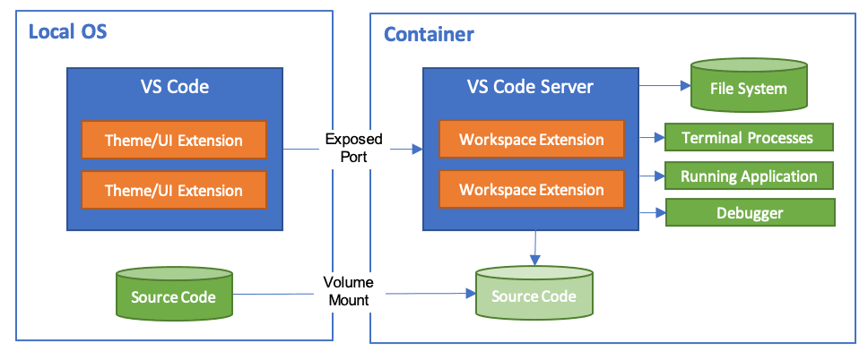

## 开发环境搭建

### vscode 环境 

- c++ 环境配置: https://code.visualstudio.com/docs/cpp/config-linux

#### 方式一: vscode 使用远程 linux 环境

#### 方式二: 使用 vscode 的 devcontainer 

- https://code.visualstudio.com/docs/devcontainers/containers

Remote - Containers 插件支持 2 种基本的操作模型：

1、把容器作为你的全功能开发环境

2、连接一个运行中的容器来查看容器内部

开发容器配置既可以放在项目根路径的 .devcontainer/devcontainer.json 文件中，也可以放在项目根路径的 .devcontainer.json 文件中。

官方开发使用的镜像: https://github.com/devcontainers/images/tree/main/src

#### vscode 建议的插件

- [code runner](https://github.com/formulahendry/vscode-code-runner) : 运行多种语言的代码片段或代码文件

## 参考

